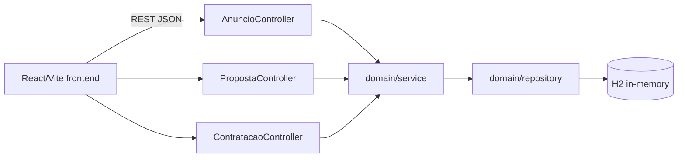

# marketplace-servicos-freelance

**English** · [Português (Brasil)](README.md)

    

## What it is

**A marketplace for freelance services** (fullstack): a **Spring Boot REST API** that manages the full cycle — service **advertisements**, provider **proposals** (accept/reject) and **engagements** — plus a **React + TypeScript + Vite web UI**. Organised as **DDD** (a `domain` package). Persistence in in-memory **H2**.

## Status

A working fullstack app (prototype/lab). API tests passing (19 tests).

## Features

- **Ads** (`AnuncioController`): `POST/GET /anuncios`, `GET /anuncios/{id}`.
- **Proposals** (`PropostaController`): `POST /propostas`, `POST /propostas/{id}/aceitar`, `POST /propostas/{id}/rejeitar`, `GET /propostas/anuncios/{anuncioId}`.
- **Engagements** (`ContratacaoController`): `POST /contratacoes` (validates that the proposal is accepted), `GET /contratacoes/{id}`.
- **Business rules** (`BusinessRuleException`): engagement requires an accepted proposal; missing resources return `404` with an error detail.
- **Domain model**: `Anuncio`, `Proposta`, `Contratacao` with status enums (`StatusAnuncio`, `StatusProposta`, `StatusContratacao`).
- **React frontend** (Vite) that consumes the API.

## Architecture

A **Spring Boot 3** backend with controller → service → repository layers over **H2**, organised as **DDD** (`domain/controller`, `domain/service`, `domain/modelo`, `domain/repository`). A **React + Vite** frontend in `frontend/`.



## Stack

- Backend: Java 21, Spring Boot 3, Spring Data JPA, H2, Maven
- Frontend: React 18, TypeScript, Vite

## Repository layout

```
marketplace-servicos-freelance/
├── pom.xml · src/                # Spring Boot backend
│   └── main/java/com/kelvinoliveira/marketplace/domain/
│       ├── controller/ · service/ · repository/
│       ├── modelo/ · dto/ · exception/
│       └── MarketplaceApplication.java
├── frontend/                     # React + Vite UI
└── README.md
```

## Prerequisites and installation

- JDK 21 and Maven 3.9+ (backend)
- Node.js ≥ 18 (frontend)

```bash
# backend (API at http://localhost:8080)
mvn spring-boot:run

# frontend
cd frontend && npm install && npm run dev
```

## How to run

```bash
# create an ad
curl -X POST http://localhost:8080/anuncios -H "Content-Type: application/json" \
  -d '{"titulo":"Build Java API","descricao":"Spring Boot API","valor":1500}'
```

## Tests and quality

Real command (verified by the agent):

```bash
mvn test
# BUILD SUCCESS — 19 tests passing (0 failures, 0 errors)
```

## Technical decisions and trade-offs

- **DDD (a `domain` package)**: separates business rules from the framework; organises controllers/services/repositories.
- **Status enums** (ad/proposal/engagement): an explicit, validable lifecycle.
- **In-memory H2**: no setup, suited to a lab; no persistence across runs.

## Known limitations and roadmap

- In-memory database and no authentication.
- No payment or rating flow between the parties.

## Development process

An individual project by Kelvin Oliveira, built with orchestrated AI agents and reviewed by the author. The domain modelling, the rules and the review are the author's.

## License and author

MIT — Copyright (c) 2026 Kelvin Rebelo de Oliveira.

**Author**: [Kelvin Oliveira](https://github.com/KelvinOliveiraCode) · [Portfolio](https://kelvinoliveiracode.github.io/portfolio/)
