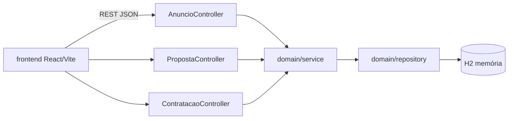

# marketplace-servicos-freelance

[English](README.en.md) · **Português (Brasil)**

    

## O que é

**Marketplace para serviços freelance** (fullstack): uma **API REST em Spring Boot** que gerencia o ciclo completo — **anúncios** de serviços, **propostas** de prestadores (aceitar/rejeitar) e **contratações** — mais uma **interface web em React + TypeScript + Vite**. Organizado como **DDD** (pacote `domain`). Persistência em **H2** em memória.

## Status

Aplicação fullstack funcional (protótipo/laboratório). Testes da API passando (19 testes).

## Funcionalidades

- **Anúncios** (`AnuncioController`): `POST/GET /anuncios`, `GET /anuncios/{id}`.
- **Propostas** (`PropostaController`): `POST /propostas`, `POST /propostas/{id}/aceitar`, `POST /propostas/{id}/rejeitar`, `GET /propostas/anuncios/{anuncioId}`.
- **Contratações** (`ContratacaoController`): `POST /contratacoes` (valida que a proposta está aceita), `GET /contratacoes/{id}`.
- **Regras de negócio** (`BusinessRuleException`): contratação exige proposta aceita; recursos inexistentes retornam `404` com detalhe de erro.
- **Modelo de domínio**: `Anuncio`, `Proposta`, `Contratacao` com enums de status (`StatusAnuncio`, `StatusProposta`, `StatusContratacao`).
- **Frontend** em React (Vite) que consome a API.

## Arquitetura

Backend em **Spring Boot 3** com camadas controller → service → repository sobre **H2**, organizado em **DDD** (pacotes `domain/controller`, `domain/service`, `domain/modelo`, `domain/repository`). Frontend **React + Vite** em `frontend/`.



## Stack

- Backend: Java 21, Spring Boot 3, Spring Data JPA, H2, Maven
- Frontend: React 18, TypeScript, Vite

## Estrutura do repositório

```
marketplace-servicos-freelance/
├── pom.xml · src/                # backend Spring Boot
│   └── main/java/com/kelvinoliveira/marketplace/domain/
│       ├── controller/ · service/ · repository/
│       ├── modelo/ · dto/ · exception/
│       └── MarketplaceApplication.java
├── frontend/                     # UI React + Vite
└── README.md
```

## Pré-requisitos e instalação

- JDK 21 e Maven 3.9+ (backend)
- Node.js ≥ 18 (frontend)

```bash
# backend (API em http://localhost:8080)
mvn spring-boot:run

# frontend
cd frontend && npm install && npm run dev
```

## Como executar

```bash
# criar anúncio
curl -X POST http://localhost:8080/anuncios -H "Content-Type: application/json" \
  -d '{"titulo":"Criar API Java","descricao":"API Spring Boot","valor":1500}'
```

## Testes e qualidade

Comando real (verificado pelo agente):

```bash
mvn test
# BUILD SUCCESS — 19 testes passando (0 falhas, 0 erros)
```

## Decisões técnicas e trade-offs

- **DDD (pacote `domain`)**: separa regras de negócio do framework; organiza controllers/serviços/repositórios.
- **Enums de status** (anúncio/proposta/contratação): fluxo de vida explícito e validável.
- **H2 em memória**: sem configuração, adequado a laboratório; sem persistência entre execuções.

## Limitações conhecidas e roadmap

- Banco em memória e sem autenticação.
- Não há fluxo de pagamento/avaliação entre as partes.

## Processo de desenvolvimento

Projeto individual de Kelvin Oliveira, construído com agentes de IA orquestrados e revisado pelo autor. A modelagem de domínio, as regras e a revisão são do autor.

## Licença e autor

MIT — Copyright (c) 2026 Kelvin Rebelo de Oliveira.

**Autor**: [Kelvin Oliveira](https://github.com/KelvinOliveiraCode) · [Portfólio](https://kelvinoliveiracode.github.io/portfolio/)
